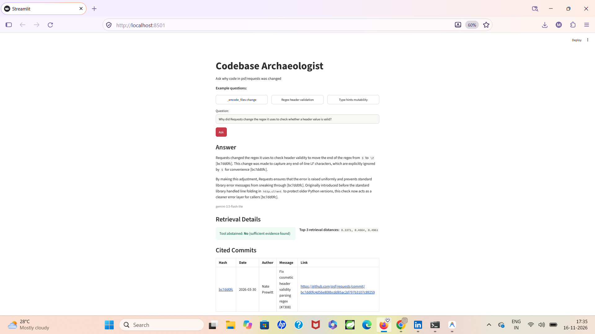

# Codebase Archaeologist

Ask **why** code in a Git repository was changed, and get an answer with commit citations.

Built and tested on [psf/requests](https://github.com/psf/requests) (Python HTTP library).



## What it does

Most tools tell you what code does today. This tool tries to answer *"why was this changed?"* by reading the Git history together with the pull request and issue text behind each commit. An LLM then answers only from that evidence and cites commit hashes, so every claim can be checked.

Example questions:

- Why did Requests change the regex it uses to check whether a header value is valid?
- Why did Requests ignore netrc entries that have no username or password?
- Why were the type hints for request headers changed to deal with mutability?

## How it works

1. **Extract (`src/extract.py`)**: PyDriller reads commits. The GitHub API fetches PR and issue text for every `#number` in a commit message. It uses the `/issues/{n}` endpoint, because issues and PRs share one number space. Responses are cached in a JSON file.
2. **Parse and track (`src/parse.py`, `src/track.py`)**: Python's `ast` splits files into functions and classes and links each commit to the functions it changed. Renames and moves are detected with a similarity heuristic (`difflib`).
3. **Index (`src/index.py`)**: Commit documents (message + PR/issue text) and function documents (identity + change history) are embedded with `all-MiniLM-L6-v2` and stored in ChromaDB. Indexing is incremental: unchanged documents are skipped.
4. **Answer (`src/qa.py`)**: Retrieve the closest documents. If the best cosine distance is above 0.70, abstain. Otherwise ask Gemini to answer only from the evidence and cite `[hash]`. Each cited hash is checked at three levels: in the retrieved evidence, exists in the repo index, or not found. If Gemini is unavailable, a structured fallback answer is built from the retrieved hits.
5. **UI (`app.py`)**: Streamlit app with the answer, retrieval distances, and a table of cited commits with GitHub links.

## Index statistics (psf/requests)

| Item | Value |
|---|---|
| Commits indexed | 300 most recent |
| Function identities tracked | 296 |
| Documents in ChromaDB | 596 |
| Commits with PR/issue text attached | 168 of 300 (56%) |
| Re-run with nothing new | 596 documents skipped in about 2 seconds |

The other 44% of commits have no `#number` in their message, so no PR or issue text could be attached.

## Benchmark

7 hand-written questions: 5 about real changes in the index and 2 out-of-scope questions about changes that never happened. I graded the answers by hand. Answer keys come from the linked PR pages. Plain Gemini is the same question sent with no repository access.

| Question | Tool correct | Tool gave the reason | Plain Gemini correct |
|---|---|---|---|
| Header validity regex (#7308) | Yes | Yes | No |
| Header type hints and mutability (#7431, #7441) | Yes | Yes | Partial |
| Malformed Content-Type parameters (#7309) | Yes | Yes | Partial |
| Empty netrc entries (#7205) | Yes | Yes | No |
| Windows proxy bypass returning true (#6302) | Yes | Partial | Yes |
| Out-of-scope: GraphQL support | Yes (declined) | n/a | Yes |
| Out-of-scope: switch to httpx | Yes (declined) | n/a | Yes |

What I take from this:

- On in-repo questions the tool gave the right reason 5 of 5 times. Plain Gemini was fully right once, partly right twice, and wrong twice. Several wrong answers were confident and detailed.
- Every claim from the tool carries a commit citation. Plain Gemini cited no commits, so its answers cannot be checked against the repo.
- On the proxy bypass question, plain Gemini gave a more detailed mechanism than the tool, which stayed vague.
- On out-of-scope questions plain Gemini was as good as the tool. It rejected the false premise directly.
- The retrieval-level abstain threshold (0.70) did not trigger on either out-of-scope question (distances 0.54 and 0.63). The refusals came from the LLM prompt rule "if the evidence does not explain why, say so".

## Limitations

- **Tiny benchmark.** 5 in-repo questions are an indication, not a statistically meaningful result. The questions were chosen from PRs that are in the index, which favors the tool.
- **Only the 300 most recent commits** are indexed (roughly late 2023 to mid 2026). Older changes are invisible.
- **The reason must be written down somewhere.** If a PR has only a title, the tool can say what changed but not why.
- **No PR text for 44% of commits.** Those commits are searchable only by message and changed functions.
- **Python files only.**
- **Rename tracking is a heuristic** and was not formally evaluated.
- **Merge commits can attach unrelated PR text.** They are not filtered yet.
- **Slow first query.** Loading the embedding model plus a Gemini call took about 35 seconds. The Streamlit app caches the model after the first load.
- **LLM availability varies.** Gemini model names change and servers are sometimes busy (404, 503, 429 during development). The app falls back to a structured answer and says so.

## Run it

Requirements: Python 3.10+, a GitHub token (public read access, no scopes), and a Gemini API key from Google AI Studio.

```
git clone https://github.com/sivakamalasri27-source/codebase-archaeologist
cd codebase-archaeologist
python -m venv venv
venv\Scripts\activate
pip install -r requirements.txt
```

Clone the repo to analyze into `repos/` (check the path in `src/extract.py`):

```
git clone https://github.com/psf/requests repos/requests
```

Create a `.env` file (never commit it):

```
GITHUB_TOKEN=your_token
GEMINI_API_KEY=your_key
```

Build the index, then start the app:

```
python -X utf8 src/index.py
streamlit run app.py
```

On Windows, `-X utf8` is needed because commit author names contain accented characters.

Run the benchmark (this overwrites `benchmark/results.csv`, so back up your hand grading first):

```
python -X utf8 benchmark/eval.py
```

## Project layout

```
src/extract.py     git history, PR and issue text
src/parse.py       ast function and class parsing
src/track.py       function history and rename detection
src/index.py       embeddings and ChromaDB
src/qa.py          retrieval, Gemini answer, citation check, abstain logic
app.py             Streamlit UI
benchmark/         ground_truth.csv, eval.py, results.csv, show_answers.py, rerun_one.py
```

## Tech

Python, PyDriller, GitHub REST API, `ast`, sentence-transformers (`all-MiniLM-L6-v2`), ChromaDB, Google Gemini API, Streamlit.
